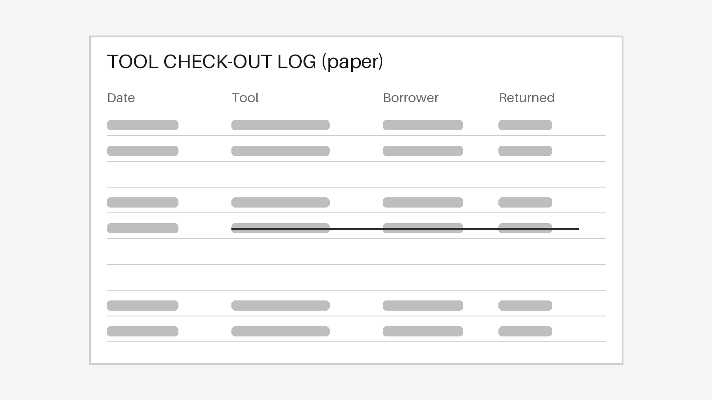
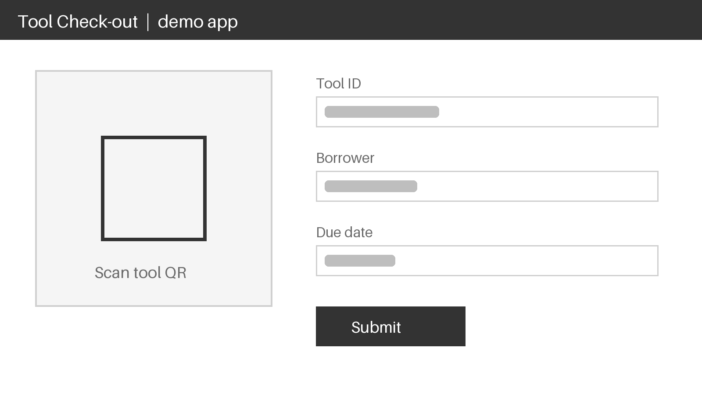
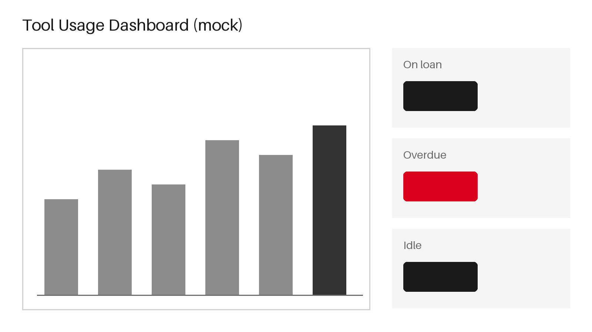

<!-- 完全虚构的示例：一家虚构工厂把工具借还从纸质登记改为扫码登记。
     覆盖封面、6 个版式和收尾页。重新生成示意图：python3 make_images.py -->

# 项目背景 / BACKGROUND
## 纸质登记让借还记录难以追溯
Tag: Oct

抽查 3 个月的登记本，约三成借出记录没有归还登记
Next: 10 月底前完成全部工具贴码

# 新流程 / PROCESS
## 借还改为扫码登记，四步完成
Layout: process
1. 贴码 | 每件工具贴唯一二维码
2. 扫码借出 | 扫码自动带出工具信息
3. 到期提醒 | 到期前一天推送提醒
4. 扫码归还 | 归还时扫码，记录自动闭环
新流程已在试点车间运行 4 周

# 借还登记 / BEFORE-AFTER
## 登记从手写改为扫码，记录自动留存
Layout: before-after
同一试点车间、同一批工具，改前改后各统计 4 周

### Before: 纸质登记

Caption: 借出时手写登记，归还靠自觉补记

### After: 扫码登记

Caption: 扫码自动带出工具信息，归还时扫码闭环

试点 4 周内借还记录全部可追溯

# 关键数据 / KEY RESULTS
## 试点 4 周，借还记录全部可追溯
Layout: stats
- 试点工具 | 120 件 | 覆盖试点车间全部手持工具
- !记录完整率 | 100% | 改前约 70%，抽查口径相同
- 单次登记用时 | 15 秒 | 改前手写约 1 分钟

# 项目节点 / MILESTONE
## 软件按计划上线，贴码比计划晚一周
Layout: timeline
- 07 Jul | 立项 | 确定试点车间与工具范围
- 04 Aug | 表单上线 | 扫码借还表单开放试用
- 25 Aug | 贴码完成 | 比计划晚一周
- 15 Sep | 试点开始 | 试点车间全部切换扫码
- 13 Oct | 试点复盘 | 4 周数据汇总

# 借还看板 / DASHBOARD
## 看板一眼看出逾期未还的工具
Layout: image-text

- 按车间显示在借、逾期、闲置数量
- 逾期数量单独标红，点开可见借用人
- 每天早班前自动刷新
看板已在试点车间晨会使用
